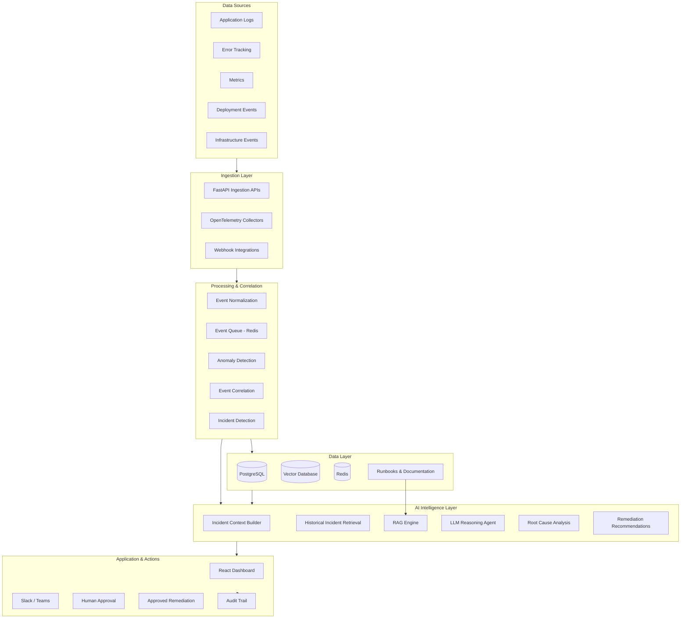
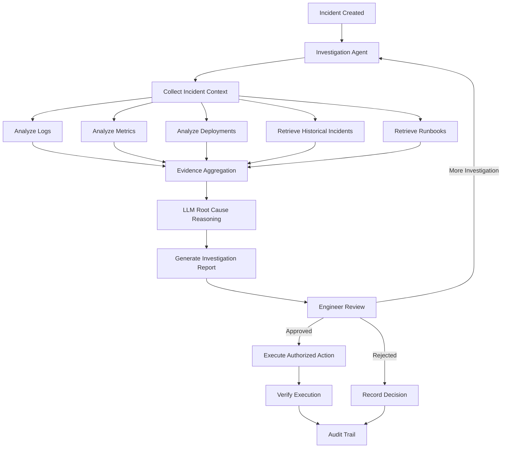

# Production AI Incident & Root-Cause Assistant

An AI-powered incident management and root-cause analysis platform that helps engineering teams detect, investigate, understand, and resolve production incidents faster.

The system collects logs, application errors, metrics, deployment events, and historical incidents from different sources. It correlates this information, retrieves relevant historical knowledge, and uses LLM-powered reasoning to generate incident summaries, identify potential root causes, surface supporting evidence, and recommend remediation steps.

The platform acts as an intelligent investigation assistant for SREs, DevOps engineers, backend engineers, and engineering teams.

**Project Type:** AI Agent / AIOps / Developer Infrastructure / Observability  
**Architecture:** Event-Driven, Modular, Service-Oriented  
**Primary Goal:** Reduce incident investigation time and improve production reliability.

---

## 1. The Problem

Modern software applications operate across distributed systems involving multiple services, databases, containers, APIs, cloud infrastructure, and third-party integrations.

When something breaks in production, engineers must investigate information scattered across multiple monitoring and infrastructure tools.

For example:

- Application logs are stored in logging platforms.
- Errors are reported through error-tracking systems.
- Metrics are available through monitoring dashboards.
- Deployment history exists in CI/CD platforms.
- Previous incidents and their solutions are documented separately.
- Runbooks contain troubleshooting procedures.

### Challenges faced by engineering teams

**1. Fragmented information**

Engineers must switch between multiple tools to understand what happened.

**2. Time-consuming investigations**

Identifying the relationship between an error, a deployment, and a metric anomaly requires manual investigation.

**3. Difficult root-cause identification**

An error is not necessarily the root cause. Engineers must examine multiple events and identify the underlying failure.

**4. Repeated troubleshooting**

Teams frequently encounter similar incidents but often repeat the same investigation because historical solutions are difficult to find.

**5. Lack of contextual information**

Traditional monitoring systems generate alerts but generally do not explain why an incident occurred or what engineers should investigate next.

**6. Slow incident resolution**

The time spent gathering information and identifying potential causes increases Mean Time to Resolution (MTTR).

---

## 2. The Proposed Solution

Build an AI-powered incident investigation assistant that connects observability data, historical incidents, engineering documentation, and AI reasoning into a unified workflow.

Instead of manually investigating multiple systems, engineers receive a centralized incident investigation report.

The system will:

- Ingest logs, application errors, metrics, and deployment events.
- Detect anomalies and correlate related events.
- Automatically create or group related incidents.
- Retrieve similar historical incidents.
- Search engineering runbooks and troubleshooting documentation using RAG.
- Generate contextual incident summaries.
- Identify multiple possible root-cause hypotheses.
- Provide supporting logs, metrics, and deployment events as evidence.
- Recommend appropriate remediation steps.
- Request human approval before executing sensitive actions.
- Maintain a complete incident timeline and audit trail.
- Notify engineering teams through Slack or Microsoft Teams.

**Core philosophy:** The system should not simply summarize errors. It should investigate incidents, reason using available evidence, explain its conclusions, and assist engineers in taking corrective action.

---

## 3. System Architecture

The platform follows a modular, event-driven architecture.

### High-Level Architecture



### Architecture Components

#### A. Data Ingestion Layer

Responsible for collecting information from different infrastructure and application sources.

Components:

- FastAPI ingestion endpoints.
- OpenTelemetry integration.
- Webhook receivers.
- Application error ingestion.
- Deployment event ingestion.
- Metrics ingestion.

Every incoming event should be validated and converted into a standardized internal event format.

#### B. Event Processing Layer

Responsible for processing and organizing incoming events.

Components:

- Event normalization.
- Event enrichment.
- Event deduplication.
- Time-based event grouping.
- Anomaly detection.
- Event correlation.
- Incident creation.

The objective is to identify relationships between events rather than treating every error independently.

#### C. Incident Intelligence Layer

The central AI intelligence component.

It receives incident context and performs investigation using:

- Historical incident retrieval.
- RAG over runbooks and documentation.
- Log and error analysis.
- Deployment correlation.
- Metric anomaly analysis.
- LLM-powered reasoning.
- Root-cause hypothesis generation.
- Remediation recommendation generation.

The AI agent must distinguish between confirmed facts, supporting evidence, and potential explanations.

#### D. Storage Layer

**PostgreSQL**
- Incidents.
- Events.
- Application metadata.
- Deployment records.
- Investigation reports.
- Remediation approvals.
- Audit logs.

**Vector Database**
- Historical incident embeddings.
- Runbook embeddings.
- Documentation embeddings.
- Previous investigation knowledge.

**Redis**
- Event queues.
- Background processing.
- Caching.
- Temporary task state.

#### E. Application Layer

A React dashboard providing a centralized interface for engineers.

It should display:

- Active incidents.
- Incident severity.
- Incident status.
- Incident timeline.
- AI-generated summaries.
- Root-cause hypotheses.
- Supporting evidence.
- Similar historical incidents.
- Recommended remediation.
- Approval requests.
- Investigation history.

---

## 4. Complete System Workflow

The following workflow describes how the system should operate from event collection to incident resolution.

### Step 1: Data Collection

The platform continuously receives information from connected applications and infrastructure.

Example:

```text
Application: Payment Service

Log:
Database connection timeout

Error:
HTTP 500 Internal Server Error

Metric:
Database connection utilization: 98%

Deployment:
Payment Service v2.4.1 deployed at 10:30 AM
```

### Step 2: Event Normalization

Different sources provide data in different formats.

The ingestion layer converts them into a standardized event structure.

Example:

```json
{
  "service": "payment-service",
  "event_type": "application_error",
  "severity": "critical",
  "message": "Database connection timeout",
  "timestamp": "2026-10-30T10:35:00Z",
  "environment": "production"
}
```

The actual schema should support source metadata, timestamps, correlation IDs, trace IDs, and service identifiers.

### Step 3: Event Processing and Correlation

The processing engine identifies related events based on:

- Service identity.
- Time proximity.
- Error patterns.
- Trace and correlation IDs.
- Deployment relationships.
- Metric anomalies.
- Infrastructure dependencies.

Example:

```text
10:30 AM - New deployment
10:32 AM - Database connections increase
10:34 AM - Request latency increases
10:35 AM - Database timeout errors appear
10:36 AM - Payment failures increase
```

These events may indicate a single underlying incident.

### Step 4: Incident Creation

When the detection engine identifies a sufficiently strong incident signal, it creates an incident.

Each incident should contain:

- Unique incident ID.
- Title and description.
- Severity.
- Affected service.
- Environment.
- Detection timestamp.
- Related events.
- Current status.

The system should avoid creating duplicate incidents for the same underlying failure.

### Step 5: Incident Context Building

Before invoking the LLM, the system builds a structured investigation context.

It collects:

- Related logs.
- Application errors.
- Metric anomalies.
- Recent deployments.
- Service dependencies.
- Infrastructure events.
- Historical incidents.
- Relevant runbooks.

This context is essential for grounded AI reasoning.

### Step 6: Historical Incident Retrieval

The RAG engine searches for incidents with similar characteristics.

Retrieval should consider:

- Semantic similarity.
- Error patterns.
- Affected services.
- Root-cause categories.
- Relevant timestamps.
- Previous remediation outcomes.

Example:

```text
Current Incident:
Database connection timeout

Similar Historical Incident:
Incident #INC-102

Previous Root Cause:
Database connection pool exhaustion

Previous Resolution:
Increased connection pool capacity
and corrected connection lifecycle handling.
```

Historical similarity must not automatically be treated as proof of the current root cause.

### Step 7: AI Investigation

The AI agent receives the structured incident context and retrieved knowledge.

It performs:

1. Incident summarization.
2. Timeline reconstruction.
3. Evidence analysis.
4. Root-cause hypothesis generation.
5. Historical incident comparison.
6. Remediation recommendation.

The agent should use structured outputs instead of unrestricted text responses.

### Step 8: Investigation Report Generation

The AI generates a structured investigation report.

Example:

**Incident:** Payment Service Database Failure

**Summary:**

Payment requests are failing because the service is experiencing database connection timeouts.

**Possible Root Causes:**

1. Database connection pool exhaustion.
2. Increased database traffic.
3. Potential regression introduced by the latest deployment.

**Supporting Evidence:**

- Database utilization reached 98%.
- Connection timeout errors increased after deployment.
- Payment request latency increased.
- A similar historical incident was caused by connection pool exhaustion.

**Recommended Actions:**

- Inspect database connection pool utilization.
- Compare the latest deployment with the previous version.
- Inspect database connection lifecycle handling.
- Consider rolling back the deployment if the evidence supports a deployment-related regression.

**Confidence:** Medium.

**Important:** Every hypothesis should include references to supporting evidence and explicitly identify missing information or uncertainty.

### Step 9: Human Approval

The system must not execute potentially destructive production operations automatically.

An engineer reviews the investigation and chooses whether to:

- Approve a remediation.
- Reject a recommendation.
- Request additional investigation.
- Escalate the incident.
- Create a remediation ticket.

All approval decisions must be recorded.

### Step 10: Remediation and Notification

After approval, the system can execute supported actions through controlled integrations.

Examples:

- Create a GitHub issue.
- Create a Jira ticket.
- Send an incident report to Slack.
- Notify the responsible engineering team.
- Trigger an approved deployment rollback.
- Execute an approved operational runbook.

The system must verify action results and record execution status.

### Step 11: Incident Closure and Knowledge Retention

Once the incident is resolved:

- Record the resolution.
- Capture the confirmed root cause.
- Store remediation details.
- Update the incident timeline.
- Record total resolution time.
- Make the incident available for future retrieval.

This creates a continuously improving historical knowledge base.

---

## 5. Core Functional Modules

| Module | Responsibility |
|---|---|
| Ingestion Service | Collect external events and telemetry |
| Event Processor | Normalize, validate, and enrich events |
| Correlation Engine | Identify relationships between events |
| Incident Manager | Create, update, group, and close incidents |
| Anomaly Detector | Identify unusual behavior in metrics and events |
| Context Builder | Assemble relevant incident information |
| Retrieval Engine | Retrieve historical incidents and documentation |
| RAG Pipeline | Ground AI investigation in engineering knowledge |
| Investigation Agent | Analyze incidents and generate hypotheses |
| Remediation Engine | Manage recommended and approved actions |
| Notification Service | Integrate Slack, Teams, and other channels |
| Audit Service | Record investigation and action history |
| Dashboard | Provide incident visibility and interaction |

---

## 6. AI Agent Architecture

The AI agent is the primary intelligence component of this project.

It should operate through a controlled tool-based architecture rather than relying on a single LLM prompt.

### Agent Responsibilities

**1. Incident Investigation Agent**

Understands the incident and coordinates the investigation.

**2. Log Analysis Tool**

Searches and analyzes relevant application logs and errors.

**3. Metrics Analysis Tool**

Identifies metric anomalies and performance degradation.

**4. Deployment Analysis Tool**

Examines recent deployments and their relationship with incident timestamps.

**5. Historical Retrieval Tool**

Searches similar incidents and previously successful resolutions.

**6. Runbook Retrieval Tool**

Retrieves troubleshooting procedures and engineering documentation.

**7. Root-Cause Analysis Tool**

Generates and evaluates potential explanations using available evidence.

**8. Remediation Tool**

Proposes operational actions and submits them for human approval.

### Suggested Agent Workflow



### Important Agent Design Principles

- Use tools to retrieve actual system data.
- Never fabricate logs, metrics, or deployment events.
- Separate evidence from hypotheses.
- Include references to source events in AI-generated conclusions.
- Support retry and failure handling.
- Apply tool-level permissions.
- Require approval for sensitive operations.
- Maintain a complete investigation history.
- Make agent decisions observable and reproducible.

The system should support multiple specialized agents or tools where useful, but should not introduce unnecessary multi-agent complexity in the initial implementation.

---

## 7. Technology Stack

| Layer | Technology | Purpose |
|---|---|---|
| Backend | Python, FastAPI | APIs and business logic |
| Database | PostgreSQL | Structured application data |
| Cache / Queue | Redis | Background tasks and event processing |
| Telemetry | OpenTelemetry | Logs, metrics, and traces integration |
| AI | LLM APIs | Investigation and reasoning |
| Embeddings | Embedding Models | Semantic knowledge retrieval |
| Vector Database | Qdrant / pgvector | Similarity search |
| RAG | Custom RAG Pipeline | Historical knowledge retrieval |
| Frontend | React | Incident dashboard |
| Containers | Docker | Application containerization |
| Orchestration | Kubernetes | Container orchestration |
| CI/CD | GitHub Actions | Automated testing and deployment |
| Notifications | Slack / Microsoft Teams | Incident communication |

Technology choices should remain modular so that individual providers can be replaced without rewriting the entire application.

---

## 8. Suggested Project Structure

The following is the proposed initial repository organization. Keep the architecture modular and avoid unnecessary microservices until there is a real scaling requirement.

```text
production-ai-incident-assistant/
│
├── backend/
│   ├── app/
│   │   ├── api/
│   │   │   ├── ingestion.py
│   │   │   ├── incidents.py
│   │   │   ├── investigations.py
│   │   │   ├── approvals.py
│   │   │   └── webhooks.py
│   │   │
│   │   ├── core/
│   │   │   ├── config.py
│   │   │   ├── security.py
│   │   │   └── logging.py
│   │   │
│   │   ├── ingestion/
│   │   │   ├── log_ingestor.py
│   │   │   ├── error_ingestor.py
│   │   │   ├── metric_ingestor.py
│   │   │   └── deployment_ingestor.py
│   │   │
│   │   ├── processing/
│   │   │   ├── normalizer.py
│   │   │   ├── event_processor.py
│   │   │   ├── correlation_engine.py
│   │   │   └── anomaly_detector.py
│   │   │
│   │   ├── incidents/
│   │   │   ├── incident_manager.py
│   │   │   ├── incident_grouping.py
│   │   │   └── timeline.py
│   │   │
│   │   ├── ai/
│   │   │   ├── agent.py
│   │   │   ├── context_builder.py
│   │   │   ├── investigation.py
│   │   │   ├── root_cause.py
│   │   │   ├── prompts.py
│   │   │   └── tools/
│   │   │       ├── log_search.py
│   │   │       ├── metrics_analysis.py
│   │   │       ├── deployment_analysis.py
│   │   │       └── historical_retrieval.py
│   │   │
│   │   ├── rag/
│   │   │   ├── ingestion.py
│   │   │   ├── embeddings.py
│   │   │   ├── retriever.py
│   │   │   └── vector_store.py
│   │   │
│   │   ├── integrations/
│   │   │   ├── slack.py
│   │   │   ├── teams.py
│   │   │   └── github.py
│   │   │
│   │   ├── remediation/
│   │   │   ├── recommendations.py
│   │   │   ├── approval.py
│   │   │   └── executor.py
│   │   │
│   │   ├── audit/
│   │   │   └── audit_service.py
│   │   │
│   │   ├── db/
│   │   │   ├── models.py
│   │   │   ├── session.py
│   │   │   └── repositories/
│   │   │
│   │   └── main.py
│   │
│   └── tests/
│
├── frontend/
│   └── src/
│
├── infrastructure/
│   ├── docker/
│   ├── kubernetes/
│   └── monitoring/
│
├── configs/
├── docs/
├── scripts/
├── docker-compose.yml
├── .env.example
├── .gitignore
├── requirements.txt
└── README.md
```

This is a logical starting structure. The implementation agent may refine module boundaries when necessary, but must preserve clear separation of responsibilities.

---

## 9. Security, Reliability and Engineering Requirements

Because this platform interacts with production infrastructure, security and reliability are core requirements.

### Security

- API authentication and authorization.
- Role-based access control.
- Secure secret management.
- Encrypted sensitive data.
- Tenant isolation if supporting multiple organizations.
- Tool-level permissions.
- Approval-based execution.
- Input validation and sanitization.

### Reliability

- Retry mechanisms for failed ingestion.
- Idempotent event processing.
- Background task execution.
- Dead-letter handling for failed events.
- Structured application logging.
- Database transaction management.
- Health checks.
- Graceful failure handling.

### AI Reliability

- Structured LLM responses.
- Evidence-backed hypotheses.
- Source attribution.
- Confidence and uncertainty reporting.
- Context size management.
- Model failure handling.
- Protection against prompt injection from untrusted logs and documents.
- Human verification for high-impact recommendations.

### Observability

The platform must monitor itself.

Track:

- API latency.
- Event ingestion rate.
- Queue processing latency.
- Incident detection latency.
- Investigation duration.
- LLM token consumption.
- Retrieval quality.
- Failed agent executions.
- Remediation success rate.

---

## 10. Development Roadmap

Implementation should happen incrementally. Each phase must produce a working and testable system.

### Phase 1: Backend Foundation

- Initialize FastAPI application.
- Configure PostgreSQL and Redis.
- Implement database models.
- Build ingestion APIs.
- Implement event normalization.
- Add validation and basic tests.

**Deliverable:** Working event ingestion backend.

### Phase 2: Event Processing and Incident Management

- Implement background event processing.
- Build event correlation.
- Implement basic anomaly detection.
- Create incident management functionality.
- Implement incident grouping and deduplication.
- Build incident timelines.

**Deliverable:** System capable of receiving events and creating meaningful incidents.

### Phase 3: RAG and Historical Knowledge

- Implement document ingestion.
- Process runbooks and engineering documentation.
- Generate embeddings.
- Configure vector database.
- Implement semantic retrieval.
- Store and retrieve historical incidents.
- Add metadata filtering.

**Deliverable:** Functional historical incident and runbook retrieval system.

### Phase 4: AI Investigation Agent

- Implement incident context builder.
- Develop log, metrics, and deployment analysis tools.
- Build the investigation agent.
- Implement LLM-powered summarization.
- Generate root-cause hypotheses.
- Attach evidence to each hypothesis.
- Generate remediation recommendations.

**Deliverable:** AI-powered incident investigation engine.

### Phase 5: Approval and Integrations

- Implement human approval workflows.
- Build remediation execution framework.
- Add Slack integration.
- Add Microsoft Teams integration.
- Add GitHub or issue-tracking integration.
- Implement audit logging.

**Deliverable:** Controlled AI-assisted incident response system.

### Phase 6: Frontend Dashboard

- Build dashboard overview.
- Create incident listing.
- Implement incident detail pages.
- Display investigation reports.
- Display evidence and timelines.
- Implement approval interface.
- Add investigation history.

**Deliverable:** Complete interactive incident management dashboard.

### Phase 7: Production Readiness

- Dockerize services.
- Configure CI/CD.
- Add automated tests.
- Implement security controls.
- Add monitoring and tracing.
- Configure Kubernetes deployment.
- Perform load and failure testing.

**Deliverable:** Deployable production-oriented platform.

---

## 11. Future Scope

The following features are planned beyond the initial implementation.

### 1. Autonomous Incident Response

Move from AI-assisted investigation toward controlled autonomous remediation.

The system could automatically execute low-risk, pre-authorized actions while keeping high-risk operations behind human approval.

### 2. Predictive Incident Detection

Use historical metrics and event patterns to identify potential failures before they become major incidents.

### 3. Advanced Multi-Agent Architecture

Introduce specialized agents for:

- Infrastructure investigation.
- Database performance analysis.
- Application debugging.
- Security incident investigation.
- Deployment failure analysis.

### 4. Distributed Tracing Intelligence

Integrate distributed traces to identify failing services, bottlenecks, and dependency-related problems across microservices.

### 5. Automated Root-Cause Verification

After a remediation, compare system behavior before and after the action to evaluate whether the proposed cause was correct.

### 6. Continuous Knowledge Learning

Automatically incorporate resolved incidents, verified root causes, and successful remediation procedures into the knowledge base.

### 7. Multi-Cloud and Infrastructure Support

Support integrations with AWS, Azure, GCP, Kubernetes, Prometheus, Grafana, Datadog, and other infrastructure platforms.

### 8. Engineering Productivity Analytics

Provide insights into:

- Mean Time to Detect (MTTD).
- Mean Time to Acknowledge (MTTA).
- Mean Time to Resolve (MTTR).
- Most frequently failing services.
- Recurring root causes.
- Incident frequency.
- Remediation effectiveness.

---

## 12. Success Metrics

The project should be evaluated using measurable engineering and AI performance metrics.

| Metric | What it measures |
|---|---|
| MTTD | Time required to detect incidents |
| MTTR | Time required to resolve incidents |
| Event Correlation Accuracy | Correct grouping of related events |
| Retrieval Precision@K | Relevance of retrieved historical knowledge |
| Root-Cause Accuracy | Agreement with verified root causes |
| Evidence Coverage | Hypotheses supported by relevant evidence |
| False Positive Rate | Incorrect incident detections |
| Remediation Success Rate | Successful approved remediation actions |
| Agent Execution Success | Successful investigation workflows |

The system should establish baseline measurements and compare improvements against them rather than claiming performance improvements without testing.

---

## 13. Expected Final Outcome

The final product should be a centralized AI-powered production incident investigation platform.

An engineer should be able to:

1. Connect an application or infrastructure data source.
2. Send logs, errors, metrics, and deployment events.
3. View automatically detected and grouped incidents.
4. Open an incident and understand what happened.
5. Review an AI-generated investigation report.
6. Examine supporting evidence.
7. Compare the incident with historical failures.
8. Review possible root causes.
9. Approve or reject remediation recommendations.
10. Track the resolution and complete incident history.

The platform should demonstrate practical knowledge of:

- AI agents and tool calling.
- Retrieval-Augmented Generation.
- Event-driven architecture.
- Backend engineering.
- Distributed systems.
- Observability and OpenTelemetry.
- Production reliability.
- Human-in-the-loop AI.
- External API integrations.
- Secure automation.

---

## 14. Instructions for the AI Development Agent

**The AI coding agent must treat this README as the primary product and architecture specification.**

Follow these development principles:

1. Understand the complete architecture before implementing individual modules.
2. Build incrementally according to the development roadmap.
3. Prioritize a functional end-to-end backend before expanding into advanced features.
4. Use modular, maintainable, and reusable code.
5. Follow proper software engineering practices and separation of concerns.
6. Use asynchronous processing where appropriate.
7. Never hardcode API keys, credentials, or environment-specific configuration.
8. Provide database migrations and maintain consistent schemas.
9. Add meaningful error handling and logging.
10. Write tests for critical business logic and integrations.
11. Use mock data and simulated infrastructure events when external integrations are unavailable.
12. Do not implement fake AI capabilities that merely return predefined investigation results.
13. Keep LLM interactions grounded in actual retrieved evidence.
14. Never execute destructive production actions without the required authorization.
15. Document important architectural and implementation decisions.

### Implementation Strategy

Do not attempt to build the entire platform in one step.

First, create a working vertical slice:

**Event Ingestion → Event Processing → Incident Creation → Context Building → RAG Retrieval → AI Investigation → Evidence-Based Report → Human Approval.**

Once this workflow works end to end, expand the system with additional integrations, advanced detection, frontend functionality, and production deployment.

**Final Engineering Objective:**

Build a reliable, extensible, AI-native incident management platform that demonstrates how AI agents can operate as practical engineering assistants in real production environments—not simply as chatbots that explain error messages.